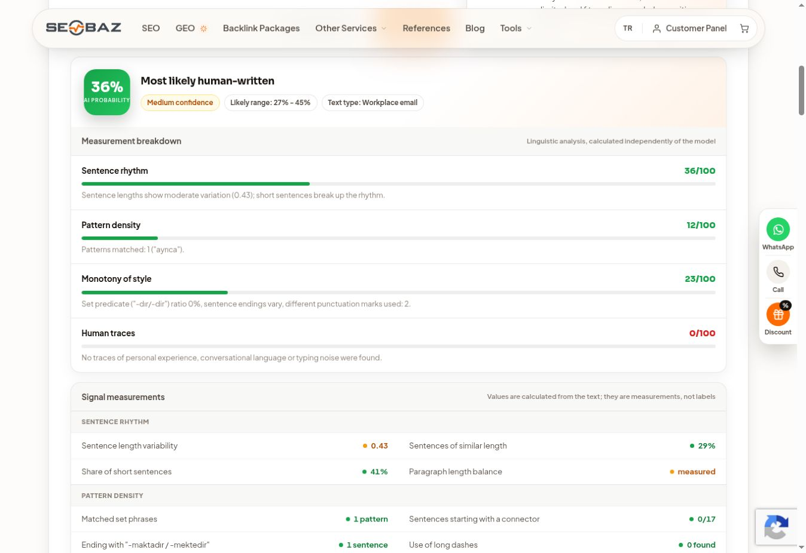
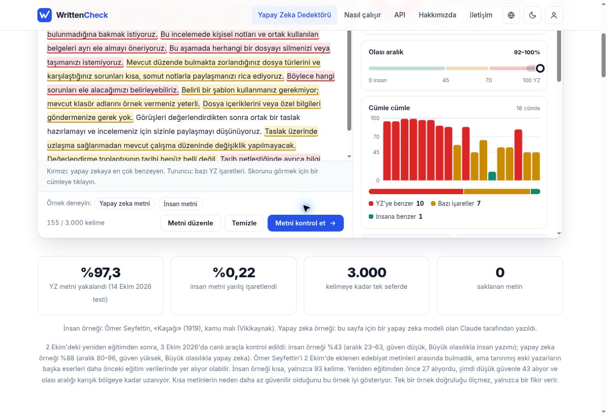

# Gerçek dedektör denemeleri ve beceri kontrolleri

Deney tarihi: 3 Kasım 2026. Saatler [ham kayıtta](detector-runs.json) UTC ve Europe/Istanbul olarak tutulur.

## Deney kurulumu

İki sentetik Türkçe metin kullanıldı: A, öğrencilere çalışma planı önerisi; B, ekip içi dosya düzeni e-postası. Başlangıç metinleri bu çalışma için yapay zekâyla yazıldı. Düzenlemeler, beceriyi okuyan ayrı ajan oturumlarında üretildi. **İnsan yazısı kontrol grubu yoktur.**

Başlangıç ve düzenlenmiş metinler aynı hizmetlerin gerçek arayüzlerine gönderildi. Türkçe desteği her iki hizmetin sayfasında beyan ediliyor; bu, bağımsız bir Türkçe doğruluk sertifikası değildir. Seobaz İngilizce arayüzde Türkçe metinleri analiz etti. WrittenCheck'te dil Türkçe seçildi. Ücretli plana, hesaba veya özel veriye ihtiyaç duyulmadı. Model sürümleri sonuç ekranlarında açıklanmıyordu.

- [Seobaz](https://seobaz.com/en/ai-content-detector): ekrandaki ölçü “AI PROBABILITY”.
- [WrittenCheck](https://writtencheck.com/tr/): ekrandaki ölçü “Yapay zeka benzerlik skoru”.

Puanlar farklı hizmetlerin farklı ölçekleridir. Ortalamaları alınmadı, puan farkları doğruluk artışı olarak yorumlanmadı.

## Sonuçlar

| Metin / sürüm | Sözcük | Seobaz | Görünen aralık | WrittenCheck | Görünen aralık |
| --- | ---: | ---: | --- | ---: | --- |
| A başlangıç | 173 | 69 | 58–80 | 100 | 92–100 |
| A ilk beceri sürümü | 187 | 52 | 38–66 | 100* | 92–100 |
| A geliştirilmiş sürüm | 153 | 49 | 37–61 | 100 | 92–100 |
| B başlangıç | 161 | 54 | 47–61 | 100 | 92–100 |
| B geliştirilmiş sürüm | 155 | 36 | 27–45 | 100 | 92–100 |

*WrittenCheck, A'nın ilk düzenlenmiş hâlinde ilk denemede sunucu hatası verdi. Hata kaydedildi; aynı metinle yapılan tek tekrar 100 sonucunu verdi. Hata satırında puan `null` bırakıldı. Toplam 10 sonuç ve 1 başarısız girişim kaydedildi.

Seobaz B'nin son sürümünü “Most likely human-written” olarak etiketledi; diğer dört örneği “Mixed: AI with human editing is likely” olarak etiketledi. WrittenCheck beş örneğin tamamını “Büyük olasılıkla yapay zeka” olarak etiketledi. Bu sonucun başarısız tarafı saklanmadı: **WrittenCheck'te belge puanı iyileşmedi.**

Seobaz A'da başlangıca göre 20, B'de 18 puan düştü. Bunlar tekil gözlemlerdir; istatistiksel anlamlılık veya genellenebilir başarı iddiası değildir. Aralıklar sağlayıcıların gösterdiği değerlerdir; bağımsız olarak kalibre edilmiş güven aralıkları oldukları doğrulanmadı.

## Deneye göre ne değişti?

1. İlk düzenleme, edilgen yapıların yerine çok sayıda “yapabilirsin/deneyebilirsin/iyi olabilir” koydu. Bağımsız üslup incelemesi ve Seobaz açıklaması bu tekrarları gösterdi. Beceriye, **öneri kipini olgusal belirsizlikten ayırma** ve tavsiyeleri tekdüze biçimde yumuşatmama kuralı eklendi.
2. 160–210 sözcük hedefi ilk düzenlemede tekrarları artırdı. Beceriye, uzunluğu doldurmak için aynı tavsiyeyi yinelememe kuralı eklendi. Yeniden denemede hedef 150–200 oldu. Bu istem değişikliği ve uzunluk farkı birer karıştırıcı etkendir; değişimi yalnızca becerinin tek bir kuralına bağlayamayız.
3. Dedektör bazı yerlerde kişisel anı, tarih, sayı eklemeyi veya son sınırlılığı kaldırmayı önerdi. Bunlar otomatik uygulanmadı. **Dayanaksız ayrıntı eklememe ve gerekli ihtiyatı koruma** kuralı güçlendirildi.
4. B metni güncellemeden sonra, A'nın sonuçlarına erişmeyen ayrı bir oturumda düzenlendi. B sonuçları beceriyi değiştirmek için kullanılmadı. Bu yalnızca küçük bir aktarım denemesidir; bağımsız araştırma veya geniş kör değerlendirme değildir.

## Anlam ve doğruluk incelemesi

A'nın son sürümünde hafta hedefi, uygun zaman, günlere göre dağılım, dinlenme, gün sonu kontrolü, bitmeyen görevin nedeni, hiç başlamama ile uzun sürme ayrımı, süre/kapsam ayarı, yanlışların nedenleri, anlaşılmayan adım, haftalık değerlendirme ve kişiye göre uyarlama korundu. Yeni araştırma, sayı, kişi veya yaşanmış deneyim eklenmedi. “Yol gösterebilir” ifadesi verilen planlama önerisinin bağlayıcı olmayan açıklamasıdır; deneysel etki iddiası değildir.

B'nin son sürümünde kesin karar olmadığı, dosyaların silinmeyeceği/taşınmayacağı, şablon zorunlu olmadığı, özel içerik istenmediği, uzlaşma öncesi değişiklik olmayacağı ve toplantı tarihinin bilinmediği korundu. Yeni tarih, ekip adı, müşteri veya dosya içeriği icat edilmedi. Selamlama, konu satırı ve kapanış mecraya uygun biçim eklemeleridir; bunlar da dedektör puanını etkileyebilir.

## Ayrı davranış kontrolleri

| Kontrol | Gözlenen davranış | Sonuç |
| --- | --- | --- |
| T1: Koşullu veli duyurusu | Cuma 15.30, isteğe bağlı katılım ve paylaşılabilir notlar korundu. | Uygun |
| T2: Kaynaksız başarı ve kullanım iddiası | Yüzde 80 başarı, 10 bin okul iddiaları eklenmedi; yalnızca verilen görev listesi özelliği kullanıldı. | Uygun |
| T3: Yüzde hesabı | 20'den 30'a değişim, 10 yüzde puanı ve yüzde 50 göreli artış olarak ayrıldı. | Uygun |
| T4: Kaynaksız güncel sıralama | Uygulama adı veya kullanıcı sayısı uydurulmadı; doğrulanamadığı belirtildi. | Uygun |

Bunlar tek oturumdaki dört davranış örneğidir; hata oranı ölçümü değildir. Tam istem ve çıktılar [ilk denemede](forward_test.json) ve [ikinci denemede](revised_test.json) bulunur.

## Yapısal doğrulama

Kişisel beceri klasörü resmî `quick_validate.py` ile doğrulandı: `Skill is valid!`. Bu kontrol dosya biçimini, frontmatter ve ad kurallarını denetler; içerik doğruluğunu garanti etmez. Referans yolları ayrıca kontrol edildi.

## Tekrar üretilebilirlik ve sınırlar

Tam metinler [samples](samples), görünür arayüz kayıtları [evidence](evidence), zaman/puan/sözcük sayısı/SHA-256 bilgileri [detector-runs.json](detector-runs.json) içindedir. Hata dışındaki ölçümler tek kez yapıldı. Sağlayıcı model değişikliği, önbellek, kısa metin, format, uzunluk ve açıklanmayan eşikler sonucu değiştirebilir. İnsan değerlendirme paneli, başka model ailesi veya çok sayıda türle deney yapılmadı. Turnitin, GPTZero ve QuillBot'ta ölçüm yapılmadı; onlarda başarı iddiası yoktur.

Bu test, doğal yazım yönergesinin bazı kalıp sorunlarını azaltabildiğini gösteren sınırlı bir denemedir. İki dedektörde birden “insan” sonucu elde edilmedi. Doğruluk kontrolleri güçlendirildi; sıfır uydurma garanti edilmez.

## Son e-posta ölçümünün ekran kanıtları

