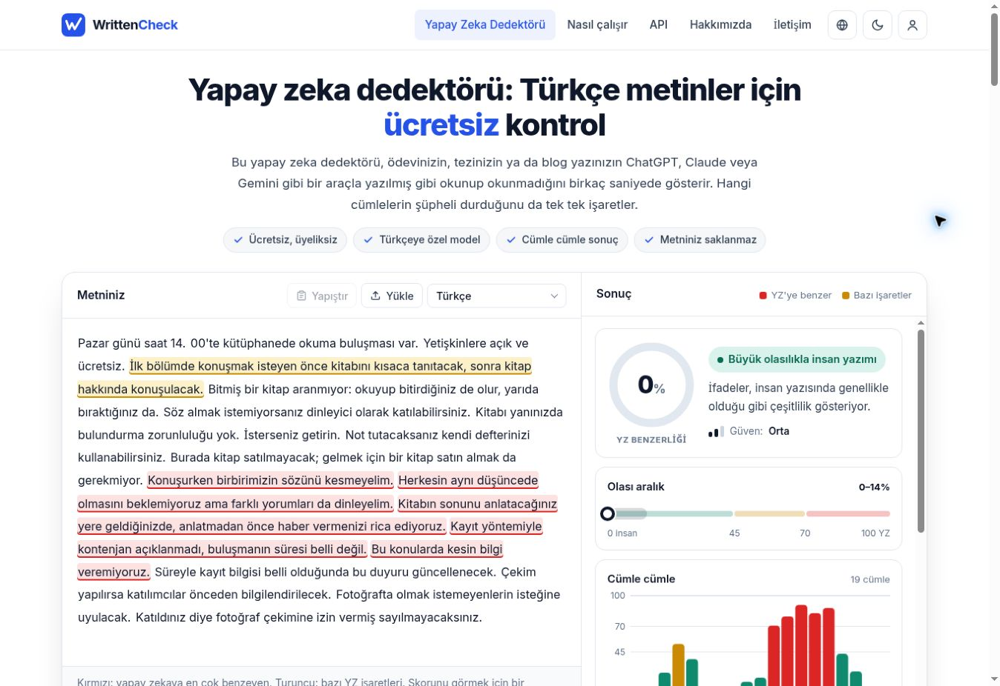
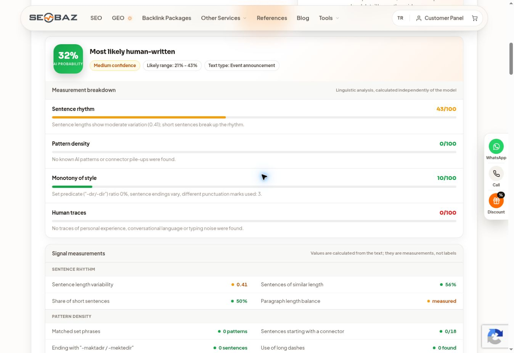

# V4: %88 teşhisi, tekrarlı denemeler ve sonuç

3 Kasım 2026. **Son duyuru C-R13: WrittenCheck 0, Seobaz 32.** İkisi de insan yazımına benzer etiketini verdi; 10 ve altı hedefi yalnız WrittenCheck'te gerçekleşti. Bu sonucun diğer metinlere aktarıldığı gösterilemedi: ayrı e-posta 100 aldı.

## %88 nereden geliyordu?

V3 sonucunda derin dil modeli 88, yerleşik model 33, yüzey üslup kontrolü 5, cümle tekdüzeliği 38, tahmin edilebilir ifadeler 20 idi. 18 cümle parçasından 12'si insana benzer görünüyordu. Bu nedenle toplam puanı cümle renklerinden veya kalıp kelimelerden çıkarmak yanlıştı.

[WrittenCheck'in kendi açıklamasına](https://writtencheck.com/how-it-works) göre derin model yanıt verdiğinde toplamı o belirler; yerleşik model yedektir. Site ve API aynı puanlayıcıyı kullanmayabilir. Açıklama 3 Kasım 2026'da okundu. Bu servis beyanıdır; özel model ağırlıklarına erişilmedi. Tam olarak hangi kelimenin transformer kararına neden olduğu bilinmiyor. 88, metnin %88'inin yapay zekâ tarafından yazıldığının kanıtı değildir.

## Bütün WrittenCheck sonuçları

Başlangıç V3 duyurusu: 154 hizmet kelimesi, 88 (74–100), orta güven. Bu tarihsel sonuç yeniden ölçülmedi.

| Aday | Hizmet kelime sayısı | Toplam puan | Aralık | Güven |
| --- | ---: | ---: | --- | --- |
| c-r1 | 151 | 100 | 92–100 | Yüksek |
| c-r2 | 147 | 100 | 92–100 | Yüksek |
| c-r3 | 152 | 68 | 48–88 | Düşük |
| c-r4 | 150 | 38 | 18–58 | Düşük |
| c-r5 | 122 | 100 | 92–100 | Yüksek |
| c-r6 | 132 | 79 | 59–99 | Düşük |
| c-r7 | 137 | 61 | 41–81 | Düşük |
| c-r8 | 142 | 71 | 51–91 | Düşük |
| c-r9 | 125 | 8 | 0–28 | Düşük |
| c-r12 | 132 | 74 | 54–94 | Düşük |
| c-r13 | 128 | 0 | 0–14 | Orta |
| d-holdout | 163 | 100 | 92–100 | Yüksek |

C-R1–R9 dokuz yeni denemedir. C-R10/11 hazırlandı ancak gönderilmedi. C-R12 ve C-R13 anlam kontrolü sonrası iki ek denemedir; dolayısıyla 13 değil **11 duyuru adayı** ölçüldü. C-R14/15 de hazırlanmış fakat gönderilmemiştir. Gönderilmeyen dosyalara sıfır puan verilmedi. D-holdout ayrı e-posta görevidir; ayarlama sonuçlarını görmeden ayrı oturumda üretildi. 150–190 kelime kısıtı vardı; metin 161 yerel, 163 hizmet kelimesi oldu. Bu örneğin yüksek puanı korunmuştur.

## Seçim ve anlam kontrolü

C-R1'de gereklilik yokluğu bir tavsiyeye dönüştü: kitap bitirmek gerekmediği bilgisi, kitap bitirmeye çalışmamayı söyleyen bir emre çevrildi. Bu aday anlam bakımından elendi.

C-R9, gereksiz karar açıklaması ve yinelenen belirsizlik/fotoğraf izni cümleleri kaldırılınca 8 aldı (0–28, düşük güven). İkinci hizmette 25 (16–34, orta güven). [Skoru görmeden yapılan anlam incelemesi](meaning-review.json), önemli koşulları korunmuş buldu; ilk bölüm etiketi ve bilginin henüz açıklanmaması konularında iki küçük kesinlik kaybı saptadı.

C-R12 bunları daha uzun anlatımla geri koydu ve 74 aldı. **C-R13** aynı nüansları daha kısa ifadeyle geri koydu ve **0 (0–14, orta güven)** aldı. [Son anlam kontrolü](final-meaning-review.json) önemli bütün koşulların korunduğunu doğruladı. Kütüphane adı, kişi, tarih, deneyim veya başka olgu eklenmedi. Fotoğraf izni, ücretsiz katılım, kayıt belirsizliği ve konuşma/kitap getirme seçenekleri korunuyor. Birkaç küçük üslup pürüzü var; sıfır skor kusursuz yazı demek değildir.

C-R13 ikinci hizmette **32 (21–43, orta güven)** aldı. İki hizmetin sayıları farklı ölçülerdir; ortalamaları alınmadı. Seobaz'ın önerdiği 150+ kelimenin altında kalındı. Başlangıç 154, final 128 hizmet kelimesidir; uzunluk farkı ve çoklu değişiklikler nedeniyle düşüş tek bir düzenlemenin nedensel kanıtı değildir.

## Yeni kurallar

- Kullanıcı Türkçe metin isterken ayrıca beceri adı belirtmese de doğal anlatım ve uydurmama kuralları varsayılan.
- Açık dedektör denemelerinde 10 ve altı test hedefi; otomatik dış gönderim veya sonuç garantisi değil.
- Belge puanını belirleyen bileşeni cümle renklerinden ve yüzey puanından ayır.
- Her adayda önce anlam/koşul kontrolü, sonra üslup ve gerçek sonuç kontrolü.
- Aynı belirsizliği ya da izin şartını tekrarlama; gerekli şartı silme.
- Kullanıcı tekrar istediğinde kayıtlı çalışma gruplarıyla devam et; hedef, kota, engel ve anlamsal bozulma durumlarını açıkça kaydet.
- Başarılı örneği evrensel şablona çevirmeden farklı görevde sına. Başarısız aktarım sonucunu saklama.

## Kanıt ve sınırlar

14 tamamlanmış yeni ölçüm: 11 duyuru + 1 ayrı e-posta WrittenCheck sonucu ve 2 Seobaz karşılaştırması. Seobaz'da sonuç üretmeyen ilk düğme etkileşimi ayrıca null olarak kaydedildi; sonraki görünür işlem 32 sonucunu verdi. CAPTCHA çözülmedi, erişim engeli aşılmadı. Hizmetlerin sahte deneyim veya yeni yer bilgisi ekleme önerileri uygulanmadı.

[Makine okunur sonuçlar ve dosya özetleri](detector-runs.json), [değerlendirme](assessment.json), [dört yeni kapsam/doğruluk yanıtı](forward-responses.json), [tüm örnekler](samples/) ve [ham görünür sonuçlar](evidence/) burada bulunur. Zaman damgaları kanıt dosyasının kaydedildiği zamanı gösterir; sunucu işlem zamanı değildir.

Tüm örnekler sentetik ve AI üretimidir. Tek ayarlanmış duyurudan genel geçiş oranı hesaplanamaz. Aynı model ailesinden değerlendirme oturumları insan kontrol grubu değildir. Ayrı e-posta hedefe ulaşmadı. V2 Python denetim aracı bu güncellemede değiştirilmedi; eski 21 araç testi yeni çalıştırılmış gibi sunulmadı. Son beceri yapısı doğrulandı.

## Gerçek ekran görüntüleri

